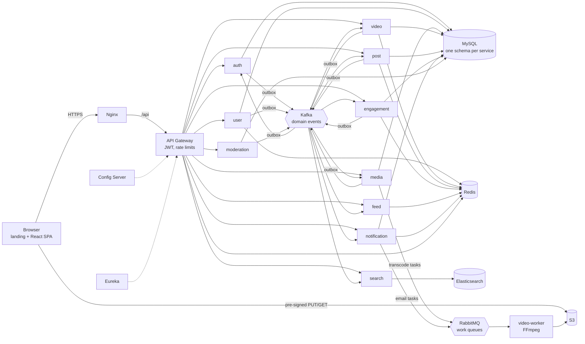

# SocialHub

A full-stack video + social platform (think YouTube and Instagram in one app), built as a
production-style microservices system for learning and as a portfolio project.

- **Videos**: upload, adaptive HLS streaming (360p/720p), channels, subscriptions, playlists,
  watch history with resume position, watch later, view counts.
- **Social**: image posts, carousels, reels, 24-hour stories with viewer lists, follows,
  #hashtags, @mentions, likes, comments with replies, bookmarks, shares.
- **Discovery**: ranked home feed (hybrid fan-out), following feed, explore, full-text search
  with typo tolerance, filters and autocomplete.
- **Real time & trust**: live notifications (SSE), email, password reset, reports, an admin
  moderation dashboard, instant account suspension.

## Architecture at a glance



Every service owns its data; services talk synchronously only to validate a request
(`/internal/**` APIs via Eureka) and otherwise through **Kafka events** written with the
**transactional outbox**. RabbitMQ carries **tasks** (transcoding, email) with retries and
dead-letter queues. Details: [docs/architecture](docs/architecture/README.md),
[event catalogue](docs/events/README.md), [API reference](docs/api/README.md).

## Tech stack

| Layer | Technology |
|---|---|
| Frontend | HTML5, CSS3, Tailwind CSS 4, vanilla JavaScript (landing); React 19, React Router 7, Context API, hls.js (app); Vite 7 |
| Backend | Java 21, Spring Boot 4.1, Spring Web, Spring Security, Spring Data JPA / Hibernate, Bean Validation, Flyway |
| Microservices | Spring Cloud Gateway, Config Server, Eureka, Spring Cloud LoadBalancer |
| Data | MySQL 8.4, Redis 7, Elasticsearch 8.15, S3 (SeaweedFS locally) |
| Messaging | Apache Kafka 3.9 (KRaft), RabbitMQ 3.13 |
| Media | FFmpeg (thumbnails, H.264/AAC HLS renditions) |
| Ops | Docker, Docker Compose, Nginx, Jenkins, Prometheus, Grafana, AWS (EC2, S3, IAM, SSM) |

## Services

| Service | Port | Responsibility |
|---|---|---|
| config-server | 8888 | Centralised configuration (`config-repo/`) |
| eureka-server | 8761 | Service discovery |
| api-gateway | 8080 | Routing, JWT validation, identity headers, Redis rate limiting, suspension denylist |
| auth-service | 8081 | Register/login, JWT + rotating refresh tokens, password reset, roles, suspension |
| user-service | 8082 | Profiles, follow graph (Redis-cached), follow events |
| media-service | 8083 | Pre-signed S3 uploads, verification, HLS playlist signing, transcode dispatch |
| video-service | 8084 | Channels, subscriptions, videos, views, playlists, history, watch later |
| post-service | 8085 | Posts, carousels, reels, hashtags, mentions, stories |
| engagement-service | 8086 | Comments, replies, reactions, bookmarks, shares, counters |
| feed-service | 8087 | Home/following/subscription feeds (hybrid fan-out in Redis) |
| search-service | 8088 | Elasticsearch indexing from events, search and autocomplete |
| notification-service | 8089 | In-app notifications, SSE push, email via RabbitMQ |
| moderation-service | 8090 | Reports, admin actions, audit log |
| video-worker | 8091 | FFmpeg transcoding from RabbitMQ tasks |

## Run it locally

Prerequisites: JDK 21, Node 22, Docker Desktop, FFmpeg (only for running the worker outside Docker).

```bash
cp .env.example .env                      # then set real passwords/secrets
docker compose up -d                      # MySQL, Redis, S3, Kafka, Elasticsearch, RabbitMQ, Mailpit
backend/common/mvnw -f backend/pom.xml package    # build and test every module
```

**Option A - everything in containers** (closest to production):
```bash
docker compose -f docker-compose.yml -f docker-compose.full.yml up -d --build
```
Open http://localhost (landing), http://localhost/app/ (app), http://localhost:3000 (Grafana),
http://localhost:8025 (emails), http://localhost:15672 (RabbitMQ).

**Option B - services from your IDE / `java -jar`** with hot-reloading frontends:
start config-server, eureka-server, then the services, then api-gateway (each reads its
config from the config server); then:
```bash
cd frontend/web && npm install && npm run dev        # http://localhost:5173
cd frontend/landing && python -m http.server 5500    # http://localhost:5500
```

Admin access: put your email in `BOOTSTRAP_ADMINS` (comma-separated) before starting auth-service.

## Tests

- `backend/common/mvnw -f backend/pom.xml verify`: unit tests for every service (business rules,
  idempotency, fan-out decisions, query building, FFmpeg rendition maths, security edge cases).
- End-to-end suites, run against the live stack during development, covered auth, media, videos,
  posts/stories, engagement, feeds, search, transcoding, notifications, email, password reset and
  moderation (200+ checks), plus browser verification of the landing site and the React app.

## Project layout

```
backend/            one Maven module per service + common library, aggregator pom.xml, Dockerfile
frontend/landing/   Steps 33-36: HTML, CSS, Tailwind and vanilla-JS landing/auth pages
frontend/web/       Steps 37-39: React app
config-repo/        Spring Cloud Config files (one per service + shared application.yml)
infra/              mysql-init, seaweedfs, nginx, monitoring (Prometheus/Grafana), jenkins, aws
docs/               architecture, events, API reference, runbooks
Jenkinsfile         CI/CD pipeline
docker-compose*.yml infra (base), full stack, production overlay
```

## Key design decisions

- **Transactional outbox** for every domain event: an event exists if and only if its change committed.
- **Idempotent consumers** (processed-event markers in the same transaction, or naturally idempotent
  Redis writes), Kafka retries with back-off and dead-letter topics.
- **External versioning in Elasticsearch** makes duplicate and out-of-order events harmless.
- **Direct-to-S3 uploads** with Content-Type and Content-Length signed into the URL, then verified
  with HeadObject; private videos restricted at the media layer too.
- **Hybrid feed fan-out**: push for normal authors, pull at read time for celebrities.
- **Redis** for caching (with after-commit eviction), rate limiting, view counters with batched
  flushes, story expiry tracking, follow-check caching, SSE fan-out and the suspension denylist.
- **Security**: access token in memory, rotating refresh tokens with reuse detection (and a 30 s
  grace window for benign retries), gateway strips client identity headers and blocks `/internal/**`,
  password reset without account enumeration, least-privilege IAM role and SSM secrets on AWS.

Deployment guide: [docs/runbooks/aws.md](docs/runbooks/aws.md).
