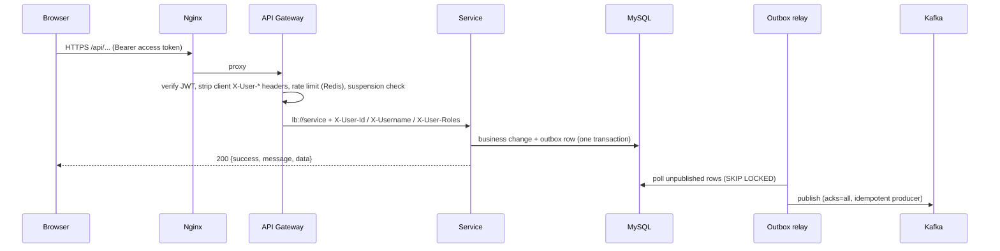
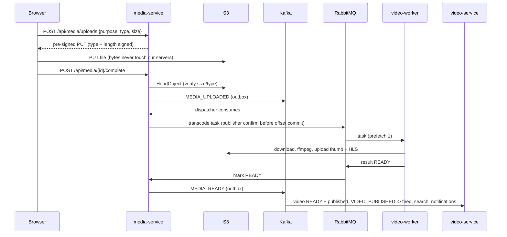

# Architecture

## Request path

## Upload and transcoding

## Data ownership

Each service has its own MySQL schema and database user (`infra/mysql-init/01-schemas.sql`);
no service reads another's tables. Cross-service data needs are met by events (read models in
Redis/Elasticsearch) or by small internal APIs used only for validation.

| Store | Holds |
|---|---|
| MySQL | source of truth: users, profiles, follows, media metadata, channels, videos, posts, comments, reactions, notifications, reports |
| Redis | caches (profiles, follow checks, targets), rate-limit buckets, view counters, story activity, feeds and follow graph (feed-service), SSE pub/sub, suspension denylist |
| Elasticsearch | search read model (videos, posts, users, channels) |
| S3 | originals, thumbnails, HLS renditions; private bucket, pre-signed URLs only |

## Security model

- Only Nginx is public. The gateway validates JWTs and forwards identity headers; services trust
  those headers because they are unreachable from outside (and the gateway strips client copies).
- `/internal/**` is rejected at Nginx and at the gateway.
- Access tokens: 15 min, held in memory by the SPA. Refresh tokens: 7 days, rotated on every use,
  stored hashed; reuse after a 30 s grace window revokes the whole session family.
- Suspension takes effect immediately through a Redis denylist checked by the gateway.
- Media: Content-Type/Content-Length signed into upload URLs, HeadObject verification, files of
  private videos restricted to their owner, bucket CORS limited to the site origin.
